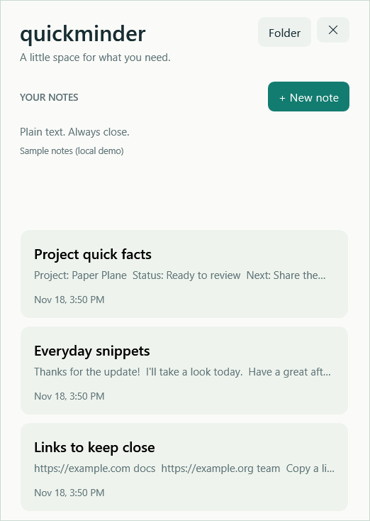
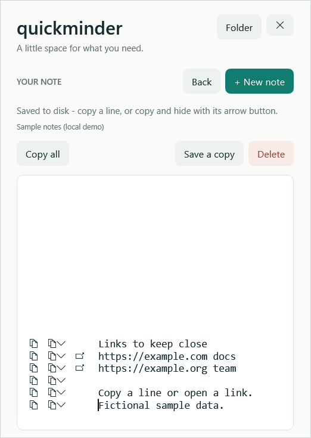

# Quickminder

A small native Windows tray app for keeping frequently used text one click away.

## Download

Get the Windows x64 installer from [GitHub Releases](https://github.com/hoopdad/quickminder/releases/latest).
Download `Quickminder-<version>-win-x64.msi`, exit any running Quickminder instance,
and open the MSI. It installs for your Windows user without administrator access,
adds a Start menu shortcut, and includes the .NET runtime. Launch **Quickminder**
from Start after installation. No automatic sign-in startup entry is added.

Uninstall through **Settings > Apps > Installed apps**. Your notes and preferences
are left intact. A portable ZIP is also provided: extract it and run `Quickminder.exe`.
Packages are currently unsigned; Windows or your organization's policies may block
them. No signing certificate is configured.

## A look inside

These are exported from the running Windows app using fictional sample notes.

| Notes at a glance | Edit, copy a line, or open a link |
| --- | --- |
|  |  |

## How it works

Click the green note icon to open a stack of notes, add a note, or open one in place.
Each logical line has a clipboard button; the editor also supports multiline paste,
normal text editing, undo, and copying the entire note.
The second clipboard button on each line copies that line and hides the popup back
to the tray. It plays a Windows confirmation sound by default; uncheck **Sound on
copy and hide** in the tray menu to turn it off. This preference survives restarts.
Clipboard failures or unsaved drafts keep the popup open rather than hiding errors.
Lines starting with a valid `http://` or `https://` URL also get a launch button.
It opens the text up to the first space in your default browser, so a line like
`https://example.com a useful label` opens only `https://example.com`.
Other URL schemes are not launched.

The note stack is anchored to the bottom of the popup, with status information
and controls above it. Editor text also grows upward from the bottom, leaving
one blank line of visual space beneath the last line. Long notes scroll upward as
you append text; editing earlier lines does not force the cursor back to the end.
Opening a note or reopening the tray popup resets horizontal scrolling to the
left edge and places the caret at the start of its line, preventing Windows from
automatically scrolling back to the right.
The blank space is layout padding, not extra text saved to your files.

## Run

Requires Windows 10/11 and the .NET 10 SDK to build:

```powershell
dotnet build Quickminder.slnx
dotnet run --project src\Quickminder
```

The popup opens at launch. Close it or press Escape to hide it, not quit.
Click the tray icon to show/hide it; right-click for folder settings or **Exit**.
The popup stays above other windows while open. `Ctrl+N` creates a note.
Launch again to bring the existing instance forward.

**Keep the tray icon visible:** Windows owns notification-area pinning. Drag the
Quickminder icon out of the tray overflow onto the taskbar, or use the tray menu's
**Tray visibility settings** and enable Quickminder under other system tray icons.
The app cannot override this Windows preference.

## Your notes

- Every text change is saved immediately to an individual `.txt` file, including blank notes.
- Default folder: `Quickminder` inside an existing OneDrive root (work, personal,
  then generic OneDrive environment setting). If OneDrive is unavailable, you
  must choose a folder; there is no silent local-only fallback.
- Use **Choose notes folder** in the tray menu to use a different local or
  synced directory. Existing files are not moved or deleted when switching.
- The first nonempty line is the note's display title. Stable generated filenames
  avoid renaming files on every title edit. Existing `.txt` files are included.
- Writes use UTF-8 and atomic replacement. OneDrive itself owns cloud sync;
  "Saved to disk" does not claim that cloud upload has completed.
- External edits refresh from filesystem events. Version checks detect changes
  before saves/deletes; an unsaved draft blocks hiding, switching notes and exit.
  Use **Save a copy** to preserve it, or explicitly discard it with **Reload from disk**.
  As with other filesystem-based editors, there is no distributed lock with
  OneDrive: simultaneous writes on different devices can still create sync conflicts.
- **Delete** asks for confirmation and permanently removes the `.txt` file,
  rather than sending it to the local Recycle Bin. OneDrive retention policies may differ.
- Folder preferences are in `%LOCALAPPDATA%\Quickminder\settings.json`.
  No account login, cloud API, database or third-party runtime is used by this app.

## Build and regression checks

```powershell
dotnet build Quickminder.slnx
dotnet run --project tests\Quickminder.Tests
```

The dependency-free Windows test executable uses an isolated temporary folder to cover
keystroke persistence, exact multiline text, restart, imported notes, conflicts,
deletion, path validation, and OneDrive discovery. Hidden WPF controls also exercise
note selection, reopening, keystroke saves, conflict warnings and draft recovery.
They measure the bottom-aligned stack, one-line editor inset, scrolling and
per-line anchors, and cover URL-token parsing and mixed newline formats.
It does not touch real notes or display test windows.

For a distributable framework-dependent build (requires .NET 10 Windows Desktop Runtime):

```powershell
dotnet publish src\Quickminder -c Release -o artifacts\Quickminder
```

Run `artifacts\Quickminder\Quickminder.exe`. No installation or login-startup entry
is made automatically. To launch at sign-in, create a shortcut to your published
executable in the folder opened by `shell:startup`.

## Sample data and screenshot maintenance

The demo is a separate live app instance with its own local notes in
`%LOCALAPPDATA%\Quickminder\Demo\Notes`. It never loads or changes your normal
folder or preferences, needs no OneDrive, and disables folder switching. On its
first empty-folder launch it creates three editable, fictional sample notes.
Restarting preserves edits and does not add duplicates.

From the repository root:

```powershell
$screenshots = Join-Path $PWD 'docs\screenshots'
dotnet run --project src\Quickminder -- --demo --screenshots "$screenshots"
```

With the default window size, press **F12** on the note stack to export
`notes-stack.png`. Open **Links to keep close** and press **F12** again to export
`note-editor.png`. The export captures the actual current WPF view at the display's
DPI, not the desktop or other apps. Only demo mode enables screenshot export.
Exit the demo through its tray icon's **Exit** menu when finished.

**Every UI change must refresh affected README screenshots in the same PR.**
Inspect the running views and the exported PNGs; use only fictional content,
and keep all personal notes and paths out of images. This requirement also lives
in [the project agent instructions](.github/copilot-instructions.md).

## Building a release

On Windows with the .NET 10 SDK:

```powershell
.\scripts\Build-Release.ps1 -Version 0.1.0
```

The script restores the pinned WiX build SDK through your configured NuGet sources,
runs the regression executable, publishes a self-contained Windows x64 single-file
app, and builds a per-user MSI. It checks the MSI's version, scope, paths and Start
shortcut, and administratively extracts it to verify that its executable has the
exact published payload's SHA-256, without
installing it on the build machine. It also creates a portable ZIP, `SHA256SUMS.txt`
and `release-record.json` containing source, build configuration, checks and hashes.
Diagnostics are retained alongside the artifacts under `artifacts\release\<version>`.
For a retry, choose a fresh `-OutputDirectory` rather than mixing build outputs.
WiX also attempts ICE validation; if Windows policy blocks it, the script reports
that limitation and records it in `release-record.json` rather than claiming it passed.
ICE91's warning about per-user-only files is expected: this installer explicitly
rejects machine-wide installation. It is recorded, not suppressed
([Microsoft's guidance](https://learn.microsoft.com/en-us/windows/win32/msi/ice91)).

Publish only from clean, committed, reviewed `main` source, tagging that exact
commit as `v<version>`. Attach the MSI, portable ZIP, checksums and release record
to the GitHub Release. Dirty builds are marked **validation only** and must not be
published. Increment the three-part version for each release; keep the installer's
upgrade and component GUIDs stable. Signing requires a separately provisioned
certificate; never commit signing keys.

The **Windows installer** GitHub Actions workflow builds and checks packages on
each PR. After review and merge, run it manually from `main` with the release
version to publish the installer, ZIP, checksums and release record. Publication
requires clean main source, matching artifact hashes and completed ICE validation
on the Windows runner; local policy-blocked validation builds cannot be released
through this workflow.
